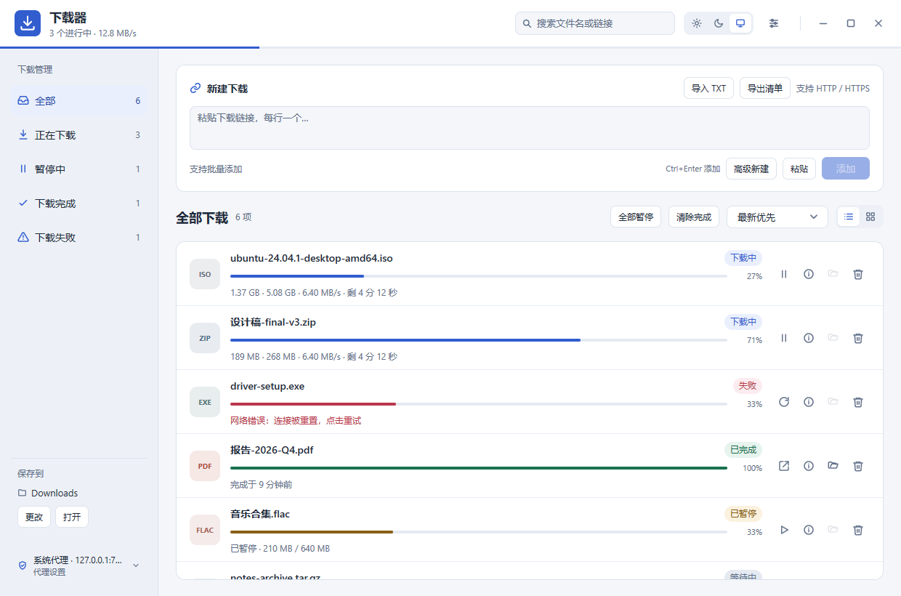
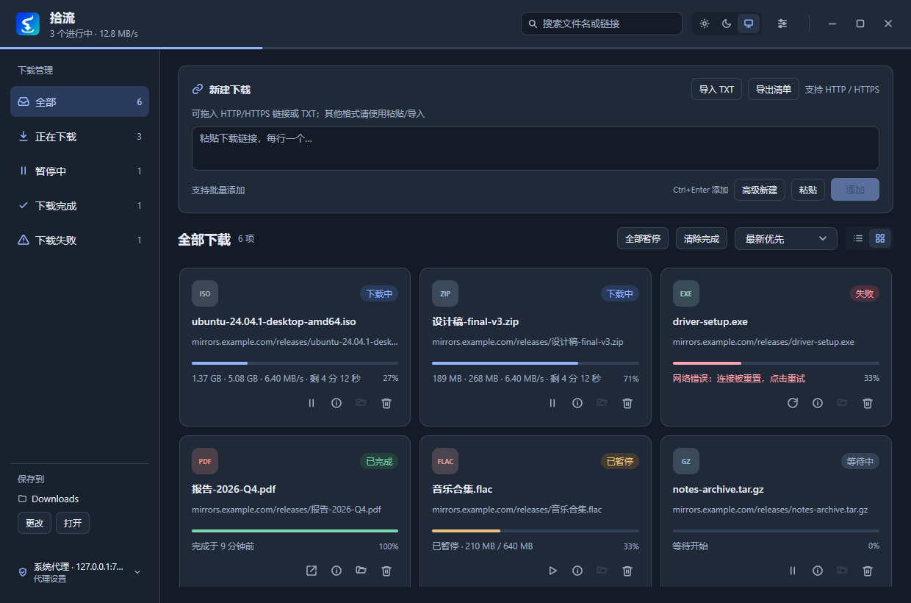

# 下载器 · Downloader

使用 Go 与 [MyGo](https://github.com/egoist/mygo) 原生 UI 编写的桌面下载器，支持 HTTP/HTTPS 下载、断点续传、代理和文件管理。界面由 MyGo 绘制，不使用 WebView 或 HTML/JavaScript 前端。

界面为简体中文，支持深色 / 浅色 / 跟随系统，以及列表与卡片两种文件管理方式。浅色主题采用冷灰底色与白色面板，深色主题采用分层石板灰，统一使用蓝色强调操作与选中状态。列表通过细分隔线组织任务，完成、暂停与失败在状态标签和进度条中保持一致的语义色。

## 界面预览





## 功能

- **从链接下载**：粘贴一条或多条 HTTP/HTTPS 链接；自动补全 `https://`，跟随重定向，从 `Content-Disposition`、URL 或 `Content-Type` 推断文件名；支持 URL 内嵌的用户名/密码（Basic Auth）。
- **批量与并发**：一次添加多条链接，按设定的并发数排队下载；支持全部暂停 / 全部继续。
- **队列优先级**：等待任务可在详情或列表/卡片右键菜单置顶、上移、下移；显示真实队列位置，顺序随任务保存，不抢占运行中的下载。
- **计划下载**：高级新建或任务详情可显式启用开始时间与每日允许时段；时段结束保留进度并释放连接，用户手动暂停优先。
- **任务清单**：从 UTF-8 TXT 导入并预览有效、重复和无效链接；导出所选或全部任务的脱敏 JSON 分享清单。
- **拖放添加**：添加区支持外部 HTTP/HTTPS URI、文本和本地 TXT 的候选预览；确认后才创建任务，可取消读取，保留粘贴和导入入口。
- **剪贴板链接提示**：默认关闭，开启后仅处理新变化；使用脱敏提示，手动确认添加或忽略，不保存剪贴板历史。
- **托盘后台模式（待原生验收）**：设置、菜单和关闭/恢复流程已实现，生产入口在平台验收通过前保持禁用并说明原因，关闭窗口仍正常退出。
- **全局限速**：在设置中指定所有任务合计的下载速度上限，单位为 KB/s（1024 字节/秒），0 表示不限速；下载中修改立即作用于后续读取，设置在重启后保留，允许少量短时突发。
- **单任务限速**：高级新建和任务详情可设置独立上限，与全局限速同时生效；修改立即影响后续读取，不重连或重置进度，任务记录在重启后保留上限。
- **文件完整性校验**：可输入预期 SHA-256，传输完成后在独立队列校验；显示进度、匹配、不匹配、取消或错误，不匹配时保留文件与下载完成状态。
- **更新失效链接**：暂停或失败任务可在详情或右键菜单更换链接，保留任务与保存路径；验证、保存和继续分开操作，无法证明资源相同时从头下载。
- **可选多连接**：每任务默认 1、范围 1–8，全局默认 16、范围 1–64；满足可靠 Range、强 ETag 和至少 8 MiB 时才启用分片，详情显示活动/等待数量和回退原因。
- **高级新建**：为单个任务指定保存目录、文件名、Referer、Cookie 和自定义请求头；指定的文件名不会被服务器建议覆盖，同名文件仍自动避让。相同链接的已停止任务可补填认证和请求头，沿用原路径与已有进度。
- **任务详情**：通过每项的详情按钮或右键菜单查看大小、进度、速度、预计剩余时间、自动重试次数、续传能力和时间信息；详情随任务更新，可复制去除 URL 凭据、查询参数值与自定义请求头的诊断信息。
- **速度曲线**：任务详情展示最近 120 秒的实际接收速度，包含多连接和重试流量；每秒至多采样一次，休眠或时钟变化显示缺口，历史只保留在内存。
- **诊断日志导出**：仅在内存保留本次运行的有界脱敏事件，在「设置 → 关于」主动导出版本化 JSON，不发送遥测。
- **代理**：
  - 无代理（直连）
  - 系统代理：Windows 读取 WinINet 注册表，macOS 读取 `scutil --proxy`，同时读取 `HTTP_PROXY` / `HTTPS_PROXY` / `ALL_PROXY` / `NO_PROXY` 环境变量
  - 自定义代理：HTTP、HTTPS、SOCKS5，支持用户名/密码与跳过列表（`localhost`、`*.local`、`10.0.0.0/8` 等），可一键测试连接
- **保存目录**：默认系统下载文件夹，可在设置中选择并校验可写；新任务即时使用新目录。
- **分类目录规则**：按扩展名或来源域名选择新任务的目录，支持规则启停、排序和命中预览；单任务显式目录优先，旧任务保持原路径。
- **文件管理**：列表 / 卡片切换、搜索、状态筛选、排序、多选批量操作、双击或点击打开文件、在文件夹中显示、复制链接或保存路径、从列表移除、删除文件。
- **断点续传**：HTTP Range + `If-Range`，单连接数据保存在 `<文件名>.part`，分片保存在 `.part.segments`，元信息在 `.part.meta`；暂停、退出、应用重启后都能继续。服务器不支持可靠 Range、验证器不足或文件版本变化时，会从头重下，避免拼接不同版本的数据。
- **体验**：自定义标题栏与窗口按钮，支持拖动、双击最大化/还原和 Windows 11 贴靠布局；深/浅色与跟随系统、下载完成系统通知、添加后自动开始（关闭时新任务以暂停状态加入）、并发数设置，两个主题都经过逐帧渲染检查。
- **中文优先**：应用文案为中文，MyGo 自带的控件、菜单与对话框也通过 `zh-Hans` 语言包显示中文。

## 快速开始

需要 Go 1.27.3 或更高版本；当前 MyGo 版本为 0.10.0，依赖版本以 [go.mod](go.mod) 为准。应用构建不需要 Node.js、Bun 或 cgo。

| 运行平台 | 要求 |
| --- | --- |
| Windows | Windows 10/11，无需 WebView2 Runtime |
| macOS | macOS 12 或更高版本 |
| Linux | GTK 3，无需 WebKitGTK |

在仓库根目录执行：

```sh
go mod download
go run .
```

开发时可自动重建并重启：

```sh
go tool mygo dev
```

首次下载依赖和工具需要网络；后续运行使用 Go 模块缓存。

## 构建与打包

检查所有包是否能够编译：

```sh
go build ./...
```

打包当前平台：

```sh
go tool mygo build
```

产物位于 `build/<os>-<arch>/`，应用名称和版本由 [mygo.json](mygo.json) 配置。升级应用版本只需修改其中的 `version`，再执行 `go tool mygo build`；安装包、可执行文件元数据、「关于」页，以及下载和代理测试请求的 User-Agent 会使用同一版本号。`go tool mygo dev` 也会注入该版本；直接 `go run .` 或 `go build` 未注入版本时使用 `dev`。

| 平台 | 主要产物 |
| --- | --- |
| Windows | `Downloader.exe` 与 `downloader-setup-<版本>-<架构>.exe` |
| macOS | `Downloader.app`，在 macOS 上可生成 `.dmg` |
| Linux | 可执行文件、`.desktop`、图标与 `.deb` |

跨平台打包：

```sh
go tool mygo build -platform windows/amd64,darwin/universal,linux/amd64
```

跨平台编译可在其他主机上进行，但 macOS 签名和 `.dmg` 制作需要 macOS。Windows 安装包使用 NSIS，MyGo 可在 Windows 上自动下载缺失的打包工具。

## 使用

1. 在顶部输入框粘贴链接，每行一个；点击「添加」或按 `Ctrl/Cmd + Enter`。需要单独配置目录、文件名或请求头时，点击「高级新建」。
2. 在侧边栏切换「全部 / 正在下载 / 暂停中 / 下载完成 / 下载失败」，用顶部搜索框过滤。
3. 每一行右侧：暂停/继续/重试、任务详情、在文件夹中显示、移除；右键还有复制链接、复制路径、删除文件等。
4. 点击右上角设置按钮，或按 `Ctrl/Cmd + ,`：
   - 常规：保存位置、同时下载数、全局限速、完成通知、添加后自动开始
   - 代理：无代理 / 系统代理 / 自定义；可查看系统代理探测结果、重新检测、测试连接
   - 外观：浅色 / 深色 / 跟随系统，默认列表或卡片
   - 关于：版本、数据目录、开源框架链接

Windows/Linux 使用 `Ctrl`，macOS 使用 `Cmd`：

| 快捷键 | 操作 |
| --- | --- |
| `Ctrl/Cmd + Enter` | 添加输入框中的下载链接 |
| `Ctrl/Cmd + ,` | 打开设置 |
| `Ctrl/Cmd + F` | 聚焦搜索框 |
| `Ctrl/Cmd + V` | 在当前输入框中粘贴 |
| `Ctrl/Cmd + A` | 下载列表获得焦点时全选任务 |
| `Esc` | 关闭当前弹窗 |

## TXT 导入与清单导出

点击新建下载区域的「导入 TXT」，选择 UTF-8 文本（允许开头的 BOM）。可按换行、空白、英文逗号或中文逗号分隔链接，省略协议时自动补全 HTTPS，例如：

```text
https://example.com/archive.zip
example.com/document.pdf
```

每次最多 10 MiB、10000 条候选，单条最多 16 KiB；超限或非法编码整批拒绝。预览显示有效、重复和无效数量及候选序号，不展示 URL 凭据或查询参数。确认前不创建任务；确认时重新去重，使用当前保存目录、同名避让和自动开始设置。创建失败会汇总，已成功的任务保留；关闭弹窗会取消后续处理。链接认证只在内存中保留并交给既有下载流程。

「导出清单」可导出所选任务或全部任务。JSON 格式固定为 `version: 1`，仅含文件名、脱敏 URL、总大小（`-1` 表示未知）、进度和状态，例如：

```json
{"version":1,"tasks":[{"fileName":"archive.zip","url":"https://example.com/archive.zip","total":-1,"done":0,"state":"paused"}]}
```

URL 用户信息、整个查询串、片段、请求头、代理配置和本地绝对路径均不会导出。**清单用于分享，不是备份**：签名参数被移除后，链接可能无法直接下载；不支持 JSON 导入、凭据或部分文件迁移。读写在后台执行，导出通过同目录临时文件完整写入后替换；提交前取消或写入失败会保留原文件。

## 剪贴板链接提示

在「设置 → 常规 → 剪贴板链接提示」开启。只处理开启后的新复制事件，不读取开启时已有内容；仅识别显式 `http://` / `https://` 链接，忽略普通域名、非文本、无效链接和超过 1 MiB 的文本。提示出现在添加区下方，不抢焦点、不自动创建任务；「添加剪贴板链接」沿用自动开始、分类目录与引擎去重，「忽略」关闭本批提示。

同一会话内，规范化链接集合、已有任务和本应用复制内容会抑制重复提示；指纹带随机盐，最多保留 256 个摘要，淘汰后允许再次提示。窗口隐藏时只保留最新候选；关闭开关或退出立即注销监听、取消解析并清除候选原文。只有偏好写入设置，剪贴板原文不进入任务记录或诊断日志；确认后创建的任务沿用已有 URL/凭据保存规则。

实现使用 MyGo 的变化通知：Windows/Linux 依赖原生事件，Linux 取决于桌面环境；macOS 由框架在注册期间每 250ms 检查变化计数。没有通知时保留手动粘贴，不增加高速轮询。MyGo 没有读取前的容量上限，1 MiB 限制约束应用保留与解析量，不保证系统读取瞬间的内存分配上限。

2026-11-22 在 Windows 11/amd64 完成原生手工验收：用户确认开启后新复制提示、忽略后的重复复制抑制及关闭后不再提示均可用；关闭状态不创建任务也由桌面观察核对。假服务和内存 UI 另覆盖通知、重复复制、关闭及晚到回调。Linux/macOS 尚未实机验收，具体环境与证据来源见 [原生传输验收记录](docs/native-transfer-acceptance.md)。

## 拖放链接与 TXT

将链接或普通 TXT 文件拖到主窗口添加区，先查看候选预览，再点击「确认导入」。同一项目优先取 URI 列表，其次纯文本，再取文件格式，避免一份拖放数据的多种表现重复创建任务。多个 TXT 合并后仍限 10 MiB、10000 条候选、单条 16 KiB；只读 UTF-8 普通文件，拒绝目录、符号链接、二进制内容、`.url`/`.webloc` 快捷方式和非 HTTP/HTTPS 下载协议。读取在后台执行，取消、替换投放或退出后丢弃旧结果。

自动化覆盖格式选择、限额、错误类型、确认前不创建、重复确认、自动开始开关、输入焦点恢复及取消。2026-11-22 已在 Windows 11/amd64 完成 Chrome 链接与 TXT 原生手工验收：直接观测浏览器 URI/Text 格式、预览和确认后的任务记录；TXT、取消及不支持类型检查由用户确认通过。环境和证据来源见 [原生传输验收记录](docs/native-transfer-acceptance.md)。macOS/Linux、其他浏览器及文件管理器组合尚未实机验证；遇到不支持的组合请使用「粘贴」或「导入 TXT」。

## 托盘后台运行与平台验收

「设置 → 常规 → 关闭窗口后继续下载」默认为关闭。仅在平台原生验收通过、托盘创建成功时允许开启；当前验收状态如下，不能开启的平台会显示原因并按原有方式正常退出。

| 平台 | 原生验收状态 | 当前关闭行为 |
| --- | --- | --- |
| Windows/amd64 | 已启动隔离实例；桌面实时输入导致点击验收暂停，关闭、托盘恢复、退出、通知及二次启动尚未完成 | 后台模式禁用，正常退出 |
| macOS | 未具备实机验收条件 | 后台模式禁用，正常退出 |
| Linux（有/无托盘宿主） | 未具备实机验收条件 | 后台模式禁用，正常退出 |

通过验收后，启用该选项会让普通关闭隐藏原窗口并保持下载；托盘菜单提供恢复窗口、活动/排队数量、总速度、全部暂停、全部继续和退出。概况由独立的两秒定时刷新更新，不依赖可见窗口重绘。通知点击和第二实例复用原窗口恢复入口。

普通退出在不可取消的 `OnQuit` 阶段取消网络、代理探测及后台文件工作并保存；系统结束会话时同步清理。可取消阶段不提前关闭引擎。单实例锁随进程结束释放；不提供开机自启、系统服务或睡眠唤醒。当前替身测试覆盖设置持久化、创建失败、平台退化、隐藏/恢复、菜单、退出取消和幂等保存，不代表原生验收已通过。

开发者可用隔离的本地验收程序继续检查（两种终端均适用）：

```sh
go test -tags nativecheck -c -o .mygo/tray-check.exe ./internal/app
```

运行 `.mygo/tray-check.exe` 会使用 `.mygo/tray-native-data/` 和本地 HTTP 服务，与真实用户数据隔离。此验收程序单独开启待验证的托盘功能；普通构建不包含它。

## 队列优先级

队列顺序独立于名称、大小、时间和状态排序，也不受搜索筛选影响。上移/下移以完整等待队列的相邻项为准：例如 A 正在下载，B、C、D 等待；即使搜索只显示 D，上移 D 后也是 B、D、C，下一空位仍交给 B，置顶 D 才变为 D、B、C。

只能调整尚未取得下载槽位的等待任务，边界操作禁用；提交时已开始或被移除的任务不会重排。暂停项保留顺序锚点，继续后回到相应位置；新任务排在末尾，删除保持其他任务的相对顺序。旧记录按原记录顺序恢复，重复或非法序号稳定修复。重启后未完成任务仍默认暂停，手动继续后按保存顺序启动；降级到旧版本不保证保留优先级。

## 计划下载

高级新建末尾勾选「启用下载计划」，或从任务详情打开「下载计划…」保存并启用。最早开始时间使用当前本地时间 `YYYY-MM-DD HH:mm` 输入，保存为 UTC 绝对时刻；留空表示无开始门槛。可另选每日 `HH:mm` 时段，起点包含、终点不包含，允许跨午夜（例如 22:00–06:00），相同起止时间无效；不设时段表示全天允许。显式启用计划可按时运行，不受普通新任务「自动开始」开关限制。

手动暂停（包括全部暂停）会阻止自动恢复；继续、全部继续和重试仍遵循启用计划的时间条件。禁用计划会暂停未完成任务，须再手动继续。时段结束取消传输并保留部分文件，释放槽位后再按原队列优先级恢复；完成任务不重复下载，失败任务需要用户重试。

只有应用运行期间会调度，最长每秒重新评估时钟与时区；不唤醒电脑、不自动启动应用。关闭或休眠期间错过开始时间，恢复后当前时段允许则入队，否则等待下一时段，不补发历史窗口。一次性开始条件达到后不会因时钟回拨撤销；每日窗口随当前系统本地时区解释，夏令时跳过的窗口不补执行，重复小时也不会创建重复 worker。已启用且未手动暂停的计划在重启后重新评估，未启用计划的旧任务仍默认暂停。

## 单任务限速

高级新建可填写「任务限速」，任务详情可直接编辑后点击「应用限速」或按 Enter。单位 KB/s 按 1024 字节换算，范围 0–1048576 KB/s（最高 1 GiB/s）；0 表示不另设任务上限，仍遵循全局上限。非法数字、负数和超出范围的输入不会覆盖有效配置。旧任务默认不另设上限。

所有读取同时获取全局与任务额度；低速任务等待自身额度时不截留全局预算，短读会退还两层未使用额度。每桶容量为速度上限的十分之一与 16 KiB 的较小值，最低 1 字节；每次在途读取最多 16 KiB，允许这些额度带来的短时突发。应在数秒窗口观察速度，不以单帧峰值判断上限。主动限速等待不计为网络停滞，暂停、移除及退出可取消等待；不提供最低带宽保证。

## SHA-256 完整性校验

在高级新建填写预期 SHA-256，或在任务详情中「保存摘要」。摘要须为 64 位十六进制，忽略首尾空白和大小写；留空表示不校验。配置摘要的下载在传输完成后自动排入独立串行校验队列，每次读取 256 KiB，不占用网络并发槽位。已经完成的任务保存摘要后，可点击「重新校验」；运行中或已排队的校验可以取消，移除任务和退出会取消工作并等待文件句柄释放。

传输状态与校验结果分别展示。摘要不匹配不会自动删除文件、重新下载或把已完成传输改为失败；完成通知仅说明传输完成，校验结果请查看任务详情。界面显示实际摘要及校验时间；修改预期摘要、检测到文件替换/删除/大小或修改时间变化时，不会把旧工作结果当成当前匹配。

预期摘要和上次结果会保存，重启后当前状态回到「待校验」，须手动重新执行；历史匹配不证明现在的文件仍相同。校验反映检查时间点的内容，不能保证之后不被其他程序修改，也不提供数字签名验证或防恶意并发改写保证。未配置摘要的旧任务不会自动扫描磁盘计算哈希。

## 多连接下载

在设置中调整新任务的默认连接数和全局连接上限，高级新建或任务详情可设置单个任务。单位是同时活动的下载请求数量，与「同时下载数」分别生效；HTTP/2 可能在同一 TCP 连接复用多个请求。全局上限立即控制后续授予，降低时等待已有连接释放；任务连接数在下次开始时生效。默认保持单连接，多连接不保证提速。

只有小范围 GET 获得有效 206、强 ETag、未压缩的已知长度且文件至少 8 MiB 时才分片；仅声明 Accept-Ranges 不够。每片固定 4 MiB，验证范围、实际字节数、总长度、版本和最终来源/路径。异常响应会取消并等待所有写入结束，清理不可信状态后最多回退一次单连接；可重试错误只重试对应片，最多 3 次，等待可取消。所有探测、下载和重试共享连接额度、代理、全局及任务限速。

分片数据独立写入 `.part.segments`；v2 `.part.meta` 只在数据 Sync 后原子提交完整区间，不能把预分配文件长度当作进度。暂停/崩溃后可能重下未提交区间；损坏或未知元信息从零恢复。旧连续 `.part` 继续单连接；已经存在的有效分片可用 1 个 worker 顺序补全。完成前检查无缝覆盖与长度、Sync 并发布唯一最终文件；配置的 SHA-256 仍独立执行。

换失效链接时，分片模式逐字节核对全部已提交区间，未提交字节与空洞不复用。降级前完成或清理分片任务并备份记录；旧版本不能恢复该格式。实测方法、吞吐/连接数/CPU 及平台验证范围见 [本地测量记录](docs/multi-connection-measurement.md)。

## 更新失效链接

先暂停任务并等待连接停止，在任务详情或右键菜单选择「更新下载链接…」。填写新地址与此次明确提供的请求头，点击「验证新链接」；失败或取消不改变旧地址与部分数据。「保存新链接」保持暂停，之后点击「继续下载」才开始传输；旧认证全部清除，新认证仅留在内存，重启后需要重新补填请求头。

仅新旧链接同源、路径完全相同（可变更查询参数），且强 ETag、已知总长度、有效 206 响应及最终响应资源一致时才考虑复用；还会重新下载完整已有前缀并逐字节对比，因此会产生额外流量，遵循代理和双层限速，可随时取消。不同源/路径、弱或缺失验证器、版本/长度变化及内容不一致都从零下载。服务器建议的文件名不会改变原目标路径。

源切换通过原子元信息与待重置标记恢复，先保存切换意图再截断；中断重启不会拼接旧字节和新源。完成检查点在任务记录成功保存后清理。降级前必须完成或清理待切换任务并备份记录，不要让旧版本处理尚未完成的源更新事务。

## 分类目录规则

在「设置 → 常规 → 分类目录规则」新增、编辑、启停或排序规则，点击「保存规则」生效。扩展名填写最后一个后缀（`zip` 或 `.ZIP` 等价，`tar.gz` 应填写 `gz`）；域名填写 `example.com` 或 `*.example.com`，忽略大小写和末尾点，支持国际化域名。域名规则不含协议、端口、路径或正则；通配规则只匹配子域，不匹配根域或 `evil-example.com`，IPv6 URL 不会误命中域名规则。

首条启用且匹配的规则生效。例如将 `zip → 压缩包目录` 放在 `*.example.com → 项目目录` 前面，`https://files.example.com/archive.ZIP` 命中压缩包目录；交换两条后命中项目目录。预览可同时填写链接和自定义文件名，目标目录必须为绝对路径。创建时才检查能否创建、写入；失败会指出原因，批量添加的其他项目仍可成功，不静默回退。

高级新建默认预填的保存目录仅供参考，仍会匹配规则；编辑目录、选择文件夹或勾选「自定义目录」才覆盖规则。快速添加、TXT 导入和高级新建共用选择逻辑。匹配只使用最初的 URL 主机及自定义文件名（未指定时用 URL 推断名），响应文件名或重定向不会重新分类。规则变化、补填认证和重启继续都不移动已有任务，最终文件及所有临时文件仍一起避让。旧设置无规则时使用默认目录，降级旧版本会忽略规则。

## 速度曲线

在任务详情向下滚动可查看「最近 120 秒速度」，包含当前速度、峰值、有效点数、缺口数量和最近采样时间。纵轴自动选择 B/s、KB/s、MB/s 或 GB/s；横轴从 120 秒前到现在。排队、暂停、失败与完成状态持续采集零速，最近的下载历史会逐渐移出窗口。

速度按实际收到的网络字节统计，多连接合计，重试流量也计入，但不会重复增加文件已下载量。由引擎定时采样，每任务每秒最多一次、最多保留 120 点，与窗口重绘无关。首次采样、超过两秒的间隔、计数异常或时钟跳变标为缺口，不补画休眠期间的数据；时间回拨清理未来点。移除任务释放缓冲，退出停止采样，重启后历史为空，不写入任务记录。

双主题的自动化样例覆盖空数据、暂停、完成、峰值及缺口，使用 960×640 窗口和 125% 缩放。每任务缓冲及大量任务快照的开销见 [速度历史测量记录](docs/speed-history-measurement.md)。

## 诊断日志导出

在「设置 → 关于 → 导出诊断日志」选择文件，后台导出一份一致快照；没有事件也能导出。页面显示已记录及已省略数量，导出期间可取消。写入使用同目录临时文件，完整写入并同步后原子替换；取消或失败不会覆盖旧文件。导出过程中到达的新事件继续进入内存缓存。

每条事件只包含时间、任务 ID、事件类型、HTTP 状态码、重试序号、来源主机及路径、错误类别。状态变化、单连接/分片重试、响应状态与代理路径请求失败会记录；代理错误类别无法确定时为 `unknown`。采集时就去掉 URL 用户信息、整个查询串与片段，不接受请求头、响应体、代理凭据、本地绝对路径、剪贴板原文或任意错误文本。来源主机和 URL 路径仍可描述访问的资源，分享前可自行检查。

主缓存最多 1000 条且事件数组编码不超过 1 MiB，单事件最多 2 KiB；过长字段直接省略，容量满时淘汰最旧事件并增加 `dropped`。下载状态的待交付缓冲也有相同上限，向外部接收器交付在下载管理器锁外执行，不做文件 I/O。事件不跨重启保存，不默认写入磁盘或发送到远程服务。

导出元数据示例（不含真实任务）：`{"version":1,"appVersion":"dev","platform":"windows/amd64","dropped":0,"events":[]}`。事件中的 `kind` 是状态名、`retry`、`http` 或 `proxy_failure`；`errorCode` 使用 `canceled`、`timeout`、`dns`、`tls`、`connection_refused`、`permission`、`not_found`、`proxy_auth` 或 `unknown`。

## 代理说明

- **系统代理**优先读取系统的原生设置；Windows 读取
  `HKCU\Software\Microsoft\Windows\CurrentVersion\Internet Settings` 的
  `ProxyEnable`、`ProxyServer`、`ProxyOverride`。若系统只配置了 PAC
  （`AutoConfigURL`），本应用不会执行 PAC 脚本，会回退到环境变量或直连，并在设置页说明。
- 环境变量支持大小写两种写法与 `ALL_PROXY`；`NO_PROXY`（或自定义的跳过列表）支持
  `<local>`、`*.example.com`、`.example.com`、`host:port`、CIDR 与 `*`。
- 代理设置**对之后开始的连接生效**，正在下载的任务不会被中断。
- 代理密码不会写入 `settings.json`：它保存在系统凭据库（Windows 凭据管理器 / macOS 钥匙串 /
  Linux Secret Service，密钥为 `proxy-password`）。凭据库不可用时，密码只在本次运行有效。
- 下载请求使用 `Accept-Encoding: identity`，避免压缩破坏 Content-Length 与 Range 语义。

## 断点续传与数据

- 单连接写入 `<保存目录>/<文件名>.part`，分片写入 `.part.segments`，旁边是记录验证器、总大小及可选已提交区间的 `.part.meta`。完成时 `rename` 为最终文件；源切换检查点等待任务记录成功保存后再清理。
- 应用每两秒把任务记录写入 `tasks.json`；退出时会把正在下载的任务置为暂停并保存。
- 数据文件位于系统的应用数据目录（Windows 通常是 `%AppData%\Downloader\`）：
  - `settings.json`：设置（不含代理密码）
  - `tasks.json`：下载记录
  - 损坏的设置或记录文件会被重命名为 `*.bad`，应用以默认值/空列表继续启动。
- 应用每两秒在后台检查已完成的文件；文件被外部移动或删除后，记录会显示「文件缺失」，可直接重新下载。
- 使用 `go run .` 与安装版时，应用数据目录可能因应用名不同而不同。

高级任务的请求头只保存在当前进程内存中，所有自定义请求头（包括 Referer、Cookie、Authorization）都不会写入任务 JSON 或 `.part.meta`。重启后需要这些请求头的任务会提示补填：在「高级新建」中输入同一链接和所需请求头即可沿用原任务；更新时填写的目录和文件名不会修改原任务路径。第一阶段不提供请求头的跨重启凭据存储。

Range、If-Range、Accept-Encoding、条件请求和连接控制等请求头由下载引擎管理，不允许自定义。自定义请求头只会随同源重定向传递；协议、主机或端口发生变化时，移除自定义请求头、Basic Auth、Cookie 和 Referer，后续跳转也不会重新附带。需要认证的跨源目标可能因此要求使用其直接链接重新创建任务。

## 项目结构

```text
main.go                         程序入口，调用 app.Run()
internal/app/
  run.go                        应用装配、单实例、语言设置与生命周期回调
  app*.go / deps.go             窗口状态、操作、设置、持久化与平台服务
  view*.go                      UI 绘制：标题栏、侧边栏、下载列表、设置与弹窗
  style.go / icons.go / format.go  主题、图标与显示格式化
  *_test.go / testdata/          应用交互测试与生成的视觉快照
internal/download/              下载队列、Range 续传、重试、文件名与任务记录
internal/diagnostics/           有界脱敏事件缓存与原子 JSON 导出
internal/appinfo/               版本标识与 User-Agent 格式
internal/proxy/                 代理配置、系统代理探测、HTTP/SOCKS5 传输
internal/settings/              设置类型
internal/rules/                 分类规则模型、验证与纯目录匹配
internal/store/                 设置与任务记录的 JSON 持久化
internal/tasklist/              有界 TXT 解析与脱敏分享清单
resources/ / mygo.json          应用图标与 MyGo 打包配置
scripts/make-icon.py            生成 resources/icon.png
```

UI 绘制、窗口状态和操作回调集中在 `internal/app`，只通过 `Run()` 向入口提供启动能力；新界面与应用操作放在该包中，下载、代理和存储等独立能力按职责放在对应的 `internal` 包中。

## 验证与视觉快照

常规检查：

```sh
go test ./...
go tool mygo vet .
```

`go tool mygo vet .` 包含 `go vet ./...`，并检查 MyGo UI 构建值的生命周期。纯 Go 验证可设置 `CGO_ENABLED=0`：

```powershell
# PowerShell
$env:CGO_ENABLED = "0"
go test ./...
```

```sh
# Bash
CGO_ENABLED=0 go test ./...
```

下载引擎的测试使用本地 `httptest` 服务器覆盖完整下载、暂停/继续、重启续传、服务器忽略 Range、
ETag 变化、并发上限、重试、404、0 字节、未知长度、基本认证、移除/删除与恢复，以及共享限速、动态限速与取消、高级任务配置、请求头重定向保护和重启后补填请求头；代理测试包含真实的
本地 HTTP 代理与最小 SOCKS5 服务器。UI 测试通过 `ui.Tester` 在内存中运行，无需打开窗口；系统代理探测测试会读取当前主机配置，但不依赖外部下载站点。

界面快照（浅/深 × 列表/卡片、选中状态、空状态、设置与确认弹窗，以及 960×640 最小窗口和 125% 缩放下的高级新建、任务详情与限速设置）用 `ui.Tester` 渲染真实像素：

```powershell
# PowerShell
$env:DOWNLOADER_SNAPSHOT = "1"
go test -run '^TestSnapshots$' -count=1 ./internal/app
```

```sh
# Bash
DOWNLOADER_SNAPSHOT=1 go test -run '^TestSnapshots$' -count=1 ./internal/app
```

快照输出到 `internal/app/testdata/snapshots/`，已被 Git 忽略。`-count=1` 用于重新执行测试，避免缓存结果。UI 有可见变化时，可从生成结果更新 `docs/` 中的对应截图。窗口拖动、贴靠及平台通知等原生行为仍需在目标系统中检查。

## 参与开发

代码组织、MyGo UI 生命周期、下载与数据约束、测试和交付要求见 [AGENTS.md](AGENTS.md)。UI 相关开发还应参考仓库中的 [mygo-maintenance 技能](.agents/skills/mygo-maintenance/SKILL.md)。

后续功能的推荐迭代顺序、范围与验收要点记录在 [迭代计划](docs/roadmap.md)，实施时在该文档中更新进度。

应用图标由 `scripts/make-icon.py` 生成，采用与界面强调色一致的钴蓝色圆角底、白色线条下载箭头与接收托盘。脚本只需 Pillow，该依赖仅用于图标生成，应用运行不需要 Python。打包图标、标题栏和「关于」页统一使用 `resources/icon.png`，界面直接嵌入该资源，两套主题下保持同一图标。修改或重新生成图标后，需要重新构建应用。

## 已知限制

- 不解析 PAC 脚本；不支持 BT/磁力、网页中的链接抓取和系统级计划任务。应用内计划不会唤醒电脑或自动启动应用。多连接只用于符合条件的 HTTP/HTTPS 文件，不保证提速。
- 单窗口、单实例；退出应用会暂停进行中的下载（下次启动可继续）。
- 代理设置不作用于已经建立的连接。
- URL 内嵌的密码只保存在内存中，不写入磁盘；重启后重新添加带认证信息的同一链接，会为原暂停任务补回凭据，保留已有下载进度，并遵循「添加后自动开始」设置。
- 界面为简体中文；未提供多语言切换。

## 许可证

本项目采用 [MIT 许可证](LICENSE)。使用的框架 [egoist/mygo](https://github.com/egoist/mygo) 同样采用 MIT 许可证。
